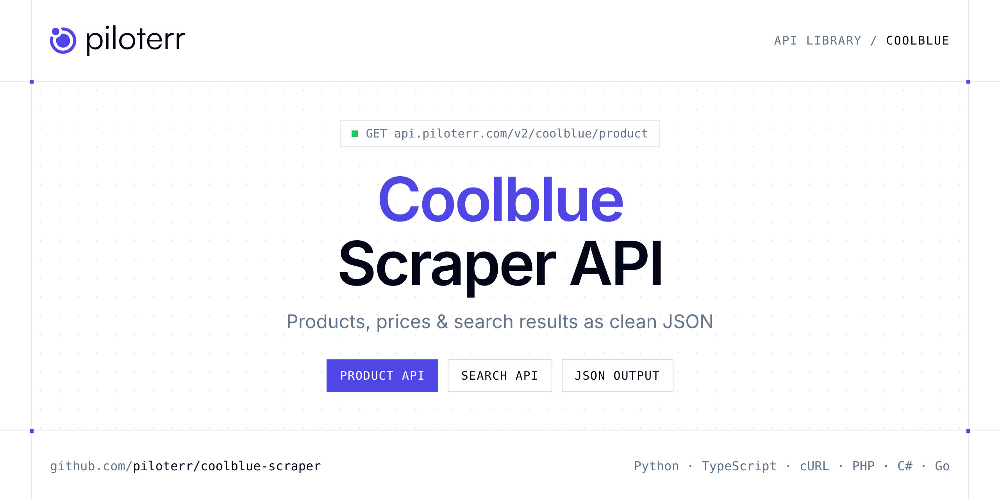

<p align="center">
  <a href="https://www.piloterr.com"></a>
</p>

# Coolblue Scraper API

[](https://discord.gg/CFj3ph8aHU) [](https://app.piloterr.com) [](https://app.piloterr.com/openapi) [](LICENSE)

The **Piloterr Coolblue Scraper API** lets you extract public data from Coolblue as **clean, structured JSON** — no proxies, headless browsers or HTML parsing to maintain. Endpoints available in production:

- **Coolblue Product API** — Read one Coolblue product by article id or product URL, in the region of that shop.
- **Coolblue Search API** — Search Coolblue with a product keyword.

Use it for price monitoring, assortment tracking, competitor analysis, product research or catalog enrichment.

| Endpoint | Path | Credits | What you get |
|---|---|---|---|
| [Coolblue Product API](#coolblue-product-api) | `/v2/coolblue/product` | 1 | Read one Coolblue product by article id or product URL, in the region of that shop. |
| [Coolblue Search API](#coolblue-search-api) | `/v2/coolblue/search` | 1 | Search Coolblue with a product keyword. Region defaults to Belgium. Also use nl or de. Page through product cards. |

## Table of contents

- [How it works](#how-it-works)
- [Coolblue Product API](#coolblue-product-api)
- [Coolblue Search API](#coolblue-search-api)
- [Code examples in other languages](#code-examples-in-other-languages)
- [Practical use cases](#practical-use-cases)
- [Why Piloterr?](#why-piloterr)
- [FAQ](#faq)
- [Official SDKs](#official-sdks)
- [Related scrapers](#related-scrapers)
- [Support](#support)

## How it works

1. **Create a free Piloterr account** and copy your API key from the [dashboard](https://app.piloterr.com).
2. **Send a `GET` (or `POST`) request** to `https://api.piloterr.com/v2/...` with the header `x-api-key: YOUR_API_KEY`.
3. **Receive structured JSON** — Piloterr handles rendering, proxies, retries and parsing.

```bash
export PILOTERR_API_KEY="your-api-key"
pip install requests        # Python
# TypeScript: Node.js 18+ (native fetch), run with `npx tsx file.ts`
```

> Every endpoint accepts both `GET` (query string) and `POST` (JSON body with the same fields).

## Coolblue Product API

Read one Coolblue product by article id or product URL, in the region of that shop.

`GET | POST https://api.piloterr.com/v2/coolblue/product` · **1 credit per request** · [Full reference](https://app.piloterr.com/openapi)

### Request parameters

| Parameter | Type | Required | Description |
|---|---|---|---|
| `query` | string | ✅ | Product link, or the article number. |
| `region` | string | — | Shop for a bare article number. |

### Python example

```python
import json
import os
import requests

response = requests.get(
    "https://api.piloterr.com/v2/coolblue/product",
    headers={"x-api-key": os.environ["PILOTERR_API_KEY"]},
    params={
        "query": "https://www.coolblue.be/nl/product/905648/sony-wh-1000xm5-zwart.html",
    },
    timeout=120,
)
response.raise_for_status()
data = response.json()

print(json.dumps(data, indent=2, ensure_ascii=False)[:2000])
```

### TypeScript example

```typescript
type CoolblueProduct = {
  sku?: string;
  url?: string;
  cons?: {
    text?: string;
    title?: unknown;
  }[];
  name?: string;
  pros?: {
    text?: string;
    title?: unknown;
  }[];
  brand?: string;
  price?: number;
  images?: string[];
  rating?: number;
  region?: string;
  currency?: string;
  language?: string;
  condition?: string;
  image_url?: string;
  in_the_box?: string[];
  product_id?: string;
  breadcrumbs?: string[];
  description?: string;
  availability?: string;
  review_count?: number;
  included_note?: string;
  price_display?: string;
  specifications?: {
    name?: string;
    group?: string;
    value?: string;
  }[];
  manufacturer_code?: string;
  availability_label?: string;
};

const params = new URLSearchParams({
  "query": "https://www.coolblue.be/nl/product/905648/sony-wh-1000xm5-zwart.html",
});

const response = await fetch(`https://api.piloterr.com/v2/coolblue/product?${params}`, {
  headers: { "x-api-key": process.env.PILOTERR_API_KEY! },
});
if (!response.ok) throw new Error(`Piloterr error ${response.status}: ${await response.text()}`);

const data = (await response.json()) as CoolblueProduct;

console.log(JSON.stringify(data, null, 2).slice(0, 2000));
```

<details>
<summary><b>POST variant</b></summary>

```http
POST https://api.piloterr.com/v2/coolblue/product
x-api-key: YOUR_API_KEY
Content-Type: application/json

{"query": "https://www.coolblue.be/nl/product/905648/sony-wh-1000xm5-zwart.html"}
```
</details>

### Output example

Example response from the API reference, abridged — real values depend on the page you scrape.

```json
{
  "sku": "905648",
  "url": "https://www.coolblue.be/nl/product/905648/sony-wh-1000xm5-zwart.html",
  "cons": [
    {
      "text": "Je vouwt de koptelefoon niet compact op.",
      "title": null
    }
  ],
  "name": "Sony WH-1000XM5 Zwart",
  "pros": [
    {
      "text": "Dankzij de topklasse noise cancelling wordt omgevingsgeluid sterk gedempt.",
      "title": null
    },
    {
      "text": "Met de Sony Headphones Connect app personaliseer je het geluid via een equalizer.",
      "title": null
    }
  ],
  "brand": "Sony",
  "price": 249,
  "images": [
    "https://image.coolblue.nl/500x500/products/1755757",
    "https://image.coolblue.nl/480x360/products/1755757"
  ],
  "rating": 8.8,
  "region": "be",
  "currency": "EUR",
  "language": "nl",
  "condition": "new",
  "image_url": "https://image.coolblue.nl/500x500/products/1755757",
  "in_the_box": [
    "Handleiding ( 3.02 MB)",
    "Opberghoes (hardcase)"
  ],
  "product_id": "905648",
  "breadcrumbs": [
    "Portable audio",
    "Koptelefoons"
  ],
  "description": "De Sony WH-1000XM5 Zwart is een draadloze koptelefoon met topklasse noise cancelling. Dankzij de 2 noise cancelling processors dempt de k…",
  "availability": "in_stock",
  "review_count": 404,
  "included_note": "Geen oplader meegeleverd",
  "price_display": "249,00 €",
  "specifications": [
    {
      "name": "Artikelnummer",
      "group": "Product",
      "value": "905648"
    },
    {
      "name": "Fabrikantcode",
      "group": "Product",
      "value": "WH1000XM5B.CE7"
    }
  ],
  "manufacturer_code": "WH1000XM5B.CE7",
  "availability_label": "Morgen geleverd"
}
```

### Response fields

| Field | Type | Description |
|---|---|---|
| `sku` | string |  |
| `url` | string |  |
| `cons[]` | object[] |  |
| `cons[].text` | string |  |
| `cons[].title` | object |  |
| `name` | string |  |
| `pros[]` | object[] |  |
| `pros[].text` | string |  |
| `pros[].title` | object |  |
| `brand` | string |  |
| `price` | integer |  |
| `images` | string[] |  |
| `rating` | number |  |
| `region` | string |  |
| `currency` | string |  |
| `language` | string |  |
| `condition` | string |  |
| `image_url` | string |  |
| `in_the_box` | string[] |  |
| `product_id` | string |  |
| `breadcrumbs` | string[] |  |
| `description` | string |  |
| `availability` | string |  |
| `review_count` | integer |  |
| `included_note` | string |  |

## Coolblue Search API

Search Coolblue with a product keyword. Region defaults to Belgium. Also use nl or de. Page through product cards.

`GET | POST https://api.piloterr.com/v2/coolblue/search` · **1 credit per request** · [Full reference](https://app.piloterr.com/openapi)

### Request parameters

| Parameter | Type | Required | Description |
|---|---|---|---|
| `query` | string | ✅ | Search words, or a Coolblue listing link. |
| `page` | number | — | Page number, from 1. |
| `region` | string | — | Shop, when query is words rather than a full link. |

### Python example

```python
import json
import os
import requests

response = requests.get(
    "https://api.piloterr.com/v2/coolblue/search",
    headers={"x-api-key": os.environ["PILOTERR_API_KEY"]},
    params={
        "query": "sony wh-1000xm5",
    },
    timeout=120,
)
response.raise_for_status()
data = response.json()

print(json.dumps(data, indent=2, ensure_ascii=False)[:2000])
```

### TypeScript example

```typescript
type CoolblueSearch = {
  results?: {
    sku?: string;
    url?: string;
    name?: string;
    price?: number;
    images?: string[];
    rating?: number;
    region?: string;
    currency?: string;
    language?: string;
    image_url?: string;
    highlights?: string[];
    product_id?: string;
    availability?: string;
    pickup_label?: string;
    review_count?: number;
    price_display?: string;
  }[];
  pagination?: {
    next?: string;
    page?: number;
    per_page?: number;
    total_pages?: number;
    total_results?: unknown;
  };
};

const params = new URLSearchParams({
  "query": "sony wh-1000xm5",
});

const response = await fetch(`https://api.piloterr.com/v2/coolblue/search?${params}`, {
  headers: { "x-api-key": process.env.PILOTERR_API_KEY! },
});
if (!response.ok) throw new Error(`Piloterr error ${response.status}: ${await response.text()}`);

const data = (await response.json()) as CoolblueSearch;

console.log(JSON.stringify(data, null, 2).slice(0, 2000));
```

<details>
<summary><b>POST variant</b></summary>

```http
POST https://api.piloterr.com/v2/coolblue/search
x-api-key: YOUR_API_KEY
Content-Type: application/json

{"query": "sony wh-1000xm5"}
```
</details>

### Output example

Example response from the API reference, abridged — real values depend on the page you scrape.

```json
{
  "results": [
    {
      "sku": "898247",
      "url": "https://www.coolblue.be/nl/product/898247/bluebuilt-usb-c-naar-usb-c-kabel-1-5m-kevlar-zwart.html",
      "name": "BlueBuilt Usb C naar Usb C kabel 1,5m Kevlar Zwart",
      "price": 29.99,
      "images": [
        "https://image.coolblue.be/transparent/max/320xauto/products/2057932",
        "https://image.coolblue.be/500x500/products/2057932"
      ],
      "rating": 8.7,
      "region": "be",
      "currency": "EUR",
      "language": "nl",
      "image_url": "https://image.coolblue.be/transparent/max/320xauto/products/2057932",
      "highlights": [
        "Onze keuze voor een extra stevige kabel voor je smartphone",
        "Kabellengte 1,5 m"
      ],
      "product_id": "898247",
      "availability": "in_stock",
      "pickup_label": "Nog sneller op te halen in 11 Coolblue-winkels",
      "review_count": 25,
      "price_display": "29,99 €"
    }
  ],
  "pagination": {
    "next": "https://www.coolblue.be/nl/kabels/oplaadkabels/usb-c-kabels/usb-c-naar-usb-c-kabels?pagina=2",
    "page": 1,
    "per_page": 22,
    "total_pages": 2,
    "total_results": null
  }
}
```

### Response fields

| Field | Type | Description |
|---|---|---|
| `results[]` | object[] |  |
| `results[].sku` | string |  |
| `results[].url` | string |  |
| `results[].name` | string |  |
| `results[].price` | number |  |
| `results[].images` | string[] |  |
| `results[].rating` | number |  |
| `results[].region` | string |  |
| `results[].currency` | string |  |
| `results[].language` | string |  |
| `results[].image_url` | string |  |
| `results[].highlights` | string[] |  |
| `results[].product_id` | string |  |
| `results[].availability` | string |  |
| `results[].pickup_label` | string |  |
| `results[].review_count` | integer |  |
| `results[].price_display` | string |  |
| `pagination` | object |  |
| `pagination.next` | string |  |
| `pagination.page` | integer |  |
| `pagination.per_page` | integer |  |
| `pagination.total_pages` | integer |  |
| `pagination.total_results` | object |  |

## Code examples in other languages

Ready-to-run examples live in the [`examples/`](examples) folder. Each one reads your key from the `PILOTERR_API_KEY` environment variable.

| Language | Product | Search |
|---|---|---|
| cURL (Bash) | [`product`](examples/curl/product.sh) | [`search`](examples/curl/search.sh) |
| PHP | [`product`](examples/php/product.php) | [`search`](examples/php/search.php) |
| C# | [`product`](examples/csharp/Product.cs) | [`search`](examples/csharp/Search.cs) |
| Go | [`product`](examples/go/product.go) | [`search`](examples/go/search.go) |
| Java | [`product`](examples/java/ProductExample.java) | [`search`](examples/java/SearchExample.java) |
| Ruby | [`product`](examples/ruby/product.rb) | [`search`](examples/ruby/search.rb) |
| Node.js | [`product`](examples/nodejs/product.mjs) | [`search`](examples/nodejs/search.mjs) |

## Practical use cases

- **Price monitoring** — Track prices, promotions and availability over time to react to competitors.
- **Assortment & catalog tracking** — Follow new products, delisted items and category changes.
- **Competitor analysis** — Benchmark ranges, brands and positioning across retailers.
- **Product research** — Spot best-sellers and trends from search results.
- **Catalog enrichment** — Pull titles, images and attributes into your PIM or marketplace listings.

## Why Piloterr?

- **No infrastructure** — no proxies, headless browsers or CAPTCHA solving to run yourself.
- **Structured JSON** — stable, documented fields instead of brittle HTML selectors.
- **Pay per request** — transparent credit cost per endpoint, failed requests are retried for you.
- **One API key, hundreds of sources** — Coolblue plus many other e-commerce, search and company data endpoints in the [Piloterr library](https://www.piloterr.com/library).
- **Any language** — plain HTTPS + JSON, with examples for Python, TypeScript, cURL, PHP, C#, Go, Java, Ruby and Node.js.

## FAQ

### Is it legal to scrape Coolblue?

Collecting publicly available data is generally allowed in many jurisdictions, but rules depend on your country, the data you collect and how you use it. Avoid personal data unless you have a lawful basis, respect the website's terms where they apply, and get legal advice for your specific use case. This is not legal advice.

### Do I need proxies or a headless browser?

No. Piloterr handles rendering, proxy rotation and retries on its side. You only send an HTTPS request with your `x-api-key` header and receive JSON.

### How much does a request cost?

Credits per call: `/v2/coolblue/product` **1**, `/v2/coolblue/search` **1**. See the [Piloterr website](https://www.piloterr.com) for plans.

### What data does the Coolblue API return?

Each endpoint returns structured JSON: **Coolblue Product** — `sku`, `url`, `cons[]`, `cons[].text`, `cons[].title`, `name`; **Coolblue Search** — `results[]`, `results[].sku`, `results[].url`, `results[].name`, `results[].price`, `results[].images`.

### How do I paginate Coolblue results?

Use the `page` parameter and keep requesting while the response indicates more results.

### Can I target a specific country or language?

Yes, use `region` — see the parameter tables above for accepted values.

### Which languages are supported?

Any language that can make an HTTP request. This README shows Python and TypeScript; the [`examples/`](examples) folder contains cURL, PHP, C#, Go, Java, Ruby and Node.js.

## Official SDKs

Use Piloterr from your own language with a typed client:

| SDK | Package | Install |
| --- | --- | --- |
| Node.js | [`@piloterr/sdk`](https://www.npmjs.com/package/@piloterr/sdk) | `npm install @piloterr/sdk` |
| Python | [`piloterr`](https://pypi.org/project/piloterr/) | `pip install piloterr` |
| Go | [`piloterr-go`](https://pkg.go.dev/github.com/piloterr/piloterr-go) | `go get github.com/piloterr/piloterr-go` |
| .NET | [`Piloterr`](https://www.nuget.org/packages/Piloterr) | `dotnet add package Piloterr` |
| Ruby | [`piloterr`](https://rubygems.org/gems/piloterr) | `gem install piloterr` |
| PHP | [`piloterr/sdk`](https://packagist.org/packages/piloterr/sdk) | `composer require piloterr/sdk` |
| Java | [`piloterr-java`](https://github.com/piloterr/piloterr-java) | build from source, see its README |
| CLI | [`@piloterr/cli`](https://www.npmjs.com/package/@piloterr/cli) | `npm install -g @piloterr/cli` |
| MCP server | [`@piloterr/mcp`](https://www.npmjs.com/package/@piloterr/mcp) | `npx -y @piloterr/mcp` |

## Related scrapers

- [About You Scraper API](https://github.com/piloterr/aboutyou-scraper)
- [Action Scraper API](https://github.com/piloterr/action-scraper)
- [Aldi Scraper API](https://github.com/piloterr/aldi-scraper)
- [Alibaba Scraper API](https://github.com/piloterr/alibaba-scraper)
- [AliExpress Scraper API](https://github.com/piloterr/aliexpress-scraper)
- [Allegro Scraper API](https://github.com/piloterr/allegro-scraper)
- [All Piloterr scrapers on GitHub](https://github.com/piloterr)

## Support

- 💬 Join the [Piloterr Discord](https://discord.gg/CFj3ph8aHU) to ask questions and share what you build.
- 📚 Browse the [API reference (OpenAPI)](https://app.piloterr.com/openapi) and the [Piloterr library](https://www.piloterr.com/library).
- 🔑 [Get your API key](https://app.piloterr.com).

---

<p align="center">
  <a href="https://www.piloterr.com">
    <picture>
      <source media="(prefers-color-scheme: dark)" srcset="images/logo-dark.svg">
      
    </picture>
  </a>
  <br>
  <sub>Built by <a href="https://www.piloterr.com">Piloterr</a> — web scraping APIs for e-commerce, search, real estate and more, one API key.</sub>
</p>

<sub>Coolblue is a trademark of its respective owner. This repository is not affiliated with or endorsed by Coolblue. Examples are released under the MIT license.</sub>
